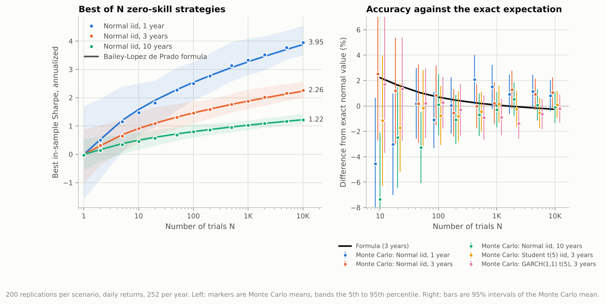
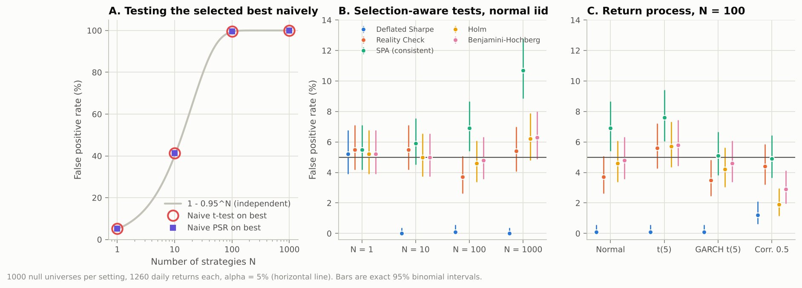
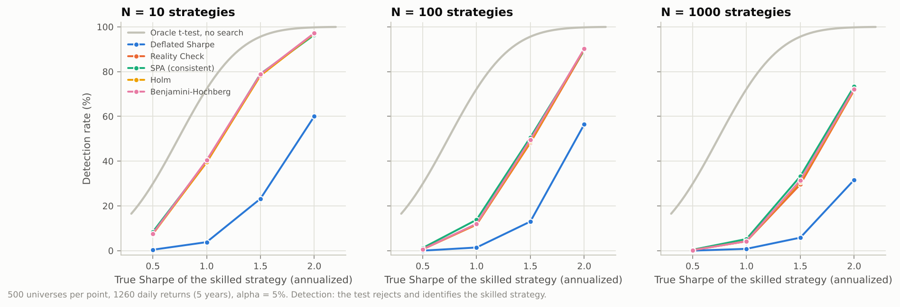
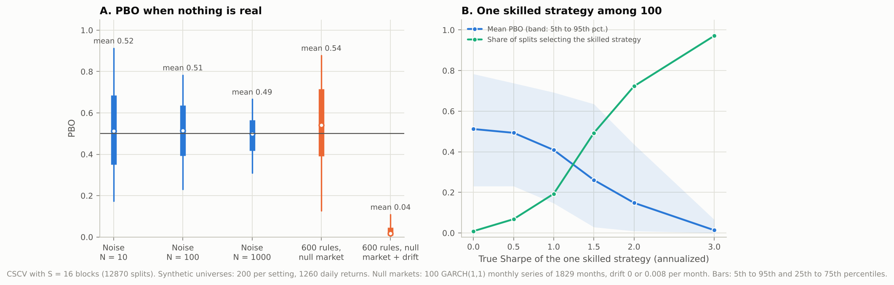
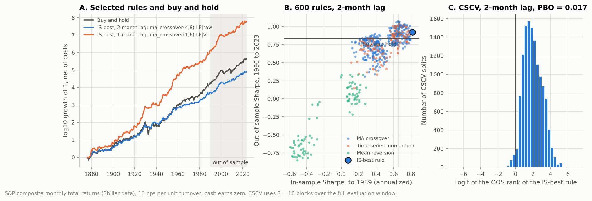

# backtest-audit

When many variants of a trading strategy are backtested and the best one is reported, its
in-sample Sharpe ratio is biased upward by the selection itself, and a standard t-test on
the winner is no longer valid. This repository implements the main corrections from the
literature (Probabilistic and Deflated Sharpe Ratio, Probability of Backtest Overfitting via
combinatorially symmetric cross-validation, White's Reality Check, Hansen's SPA test, and
Bonferroni, Holm and Benjamini-Hochberg adjustments), checks on simulated data with a known
answer how inflated naive results are and whether the corrections are calibrated, and then
applies all of them to a 600-rule timing sweep on S&P composite monthly total returns from
1871 to 2023. Author: Yosef Shammout.

## Key results

Every number below is rendered by `python -m experiments.report` from the committed files in
`results/`, which `python -m experiments.run_all` regenerates. A test fails if this table and
the result files disagree.

<!-- BEGIN key-results -->
| Finding | Number | What it means |
| --- | --- | --- |
| Best in-sample Sharpe of 10,000 zero-skill strategies, 1 year of daily data (E1) | 3.95 (formula 3.88) | Search alone, over pure noise, produces a Sharpe ratio that would look exceptional. |
| Same search with 10 years of data (E1) | 1.22 (formula 1.22) | More data shrinks the inflation, roughly with the square root of the sample length, but does not remove it. |
| Expected-maximum formula vs exact normal value, N from 10 to 10,000 (E1) | within 2.4% | The Bailey and Lopez de Prado closed form is an accurate deflation benchmark. |
| False positive rate of a naive t-test on the best of N = 10 / 100 / 1000, nominal 5% (E2) | 41.4% / 99.6% / 100.0% | Testing the winner as if it were the only strategy tried is badly miscalibrated. |
| Highest false positive rate of Reality Check, Bonferroni, Holm or BH over 7 null settings (E2) | 6.3% [4.9, 8.0]: Benjamini-Hochberg, Normal, N=1000 | These corrections hold the 5% level within sampling error in every setting tried. |
| False positive rate of SPA (consistent) at N = 1 / 100 / 1000 (E2) | 5.5% / 6.9% / 10.7% (iid-scaled diagnostic at N = 1000: 6.0%) | SPA over-rejects as N grows. The cause is studentizing by an estimated long-run variance whose noise the bootstrap ignores. |
| False positive rate of DSR at N = 10 / 100 / 1000 (E2) | 0.0% / 0.1% / 0.0% | DSR is far more conservative than 5%: it compares the best Sharpe with the expected maximum, not with an upper quantile of the maximum. |
| Detection rate, true Sharpe 1.0 among 100 strategies: SPA / Holm / DSR (E3) | 14% / 12% / 1% (oracle 72%) | A genuinely good 5-year track record is usually missed once 100 variants were tried. |
| Detection rate, true Sharpe 2.0 among 1000 strategies: SPA / Holm / DSR (E3) | 73% / 72% / 32% (oracle 100%) | Strong signals survive even a large search; the price of searching is paid in power. |
| Mean PBO on pure-noise universes, N = 10 / 100 / 1000 (E4) | 0.52 / 0.51 / 0.49 | On noise the in-sample winner is a coin flip out of sample, as PBO should report. |
| Mean PBO with one strategy of true Sharpe 3 among 100 (E4) | 0.013 | A dominant real signal drives PBO to zero. |
| PBO of the 600-rule grid on 100 simulated markets with nothing predictable (E4) | mean 0.54, 5th to 95th pct. 0.13 to 0.88 | Centered near one half, but a single history can land far from it. |
| Same, with a constant drift of 0.008 per month added (E4) | mean 0.04, 5th to 95th pct. 0.00 to 0.11 | Drift alone, with no timing skill, pushes PBO down: long/flat rules keep beating long/short ones. |
| Best in-sample rule of 600, 1876 to 1989, 2-month lag, 10 bps (E5) | ma_crossover(4,8), long/flat: Sharpe 0.82 vs 0.66 buy-and-hold | The search finds a rule that looks better than the index in sample. |
| Same rule out of sample, 1990 to 2023-06 (E5) | Sharpe 0.92 vs 0.84 buy-and-hold | It stays slightly ahead of the index out of sample, which alone says nothing about significance. |
| DSR p-value of the in-sample best, 600 trials (E5) | 0.923 (2.0e-07 with 2.6 effective trials) | Not significant with the raw trial count; the answer hinges on how correlated trials are counted, and both versions test against zero, which buy-and-hold already beats. |
| PBO, CSCV with S = 16 over 1876 to 2023 (E5) | 0.017 all rules; 0.215 long/flat only; 0.608 long/short only | Low PBO here says the winner beats a weak median rule, not that it beats the index. |
| SPA p-value, best of all rules vs buy-and-hold (E5) | 0.439 (volatility-matched 0.202) | No rule beats buy-and-hold once the search is accounted for. |
| One-month lag instead of two on averaged prices (E5) | SPA p 0.015 on the S&P; rejects on 100% of 100 averaged random walks (2-month lag: 6%) | The apparent edge is an artifact of monthly averaging, reproduced on pure noise. |
<!-- END key-results -->

## Figures



**E1.** Expected best in-sample Sharpe ratio among N strategies with true Sharpe zero, for
1, 3 and 10 years of daily returns, against the Bailey and Lopez de Prado approximation
(left), and the accuracy of Monte Carlo and formula against the exact expectation for
normal returns, including fat-tailed and GARCH returns (right).



**E2.** False positive rates at a nominal 5% level, with exact 95% binomial intervals.



**E3.** Detection rate of one strategy with a known true Sharpe ratio hidden among N.



**E4.** PBO on universes where nothing is real (left) and with one skilled strategy (right).



**E5.** The real-data sweep: growth of the selected rules (left), in-sample against
out-of-sample Sharpe for every rule (middle), and the CSCV logit distribution (right).

## Results in detail

### E1: how large is selection inflation?

Every strategy has a true Sharpe ratio of exactly zero. The best in-sample Sharpe among N
grows roughly like `sqrt(2 log N)` times the standard error of one Sharpe estimate, which is
about one over the square root of the sample length in years, so short samples are hit
hardest. The Monte Carlo means lie on the Bailey and Lopez de Prado curve, the cross-sectional
variance of the trial Sharpe ratios matches `1/T`, and the closed form stays close to the exact
expectation for normal returns, overstating it slightly at small N. Fat tails and GARCH
volatility clustering do not change the picture at three years of daily data: when the true
Sharpe ratio is zero, the skewness and kurtosis terms of the Sharpe ratio's sampling variance
vanish, so its null distribution is close to normal with variance `1/T` either way.

<!-- BEGIN selection -->
| Scenario | Best of 10,000: Monte Carlo mean +/- s.e. | Formula | Exact (normal) | Fitted / theoretical scale | Max formula error vs exact, N >= 10 |
| --- | --- | --- | --- | --- | --- |
| Normal iid, 1 year | 3.946 +/- 0.024 | 3.876 | 3.914 | 1.007 | 2.3% |
| Normal iid, 3 years | 2.259 +/- 0.014 | 2.230 | 2.236 | 1.004 | 2.2% |
| Normal iid, 10 years | 1.219 +/- 0.008 | 1.222 | 1.220 | 0.987 | 2.3% |
| Student t(5) iid, 3 years | 2.238 +/- 0.012 | 2.233 | 2.236 | 0.992 | 2.4% |
| GARCH(1,1) t(5), 3 years | 2.231 +/- 0.013 | 2.230 | 2.236 | 0.994 | 2.2% |
<!-- END selection -->

### E2: are the corrections calibrated?

Testing the selected winner as if it had been the only strategy tried rejects at the rate
`1 - 0.95^N` predicted for independent trials. The family-wise procedures (Bonferroni, Holm)
and BH, which under the global null controls the same error rate, stay within sampling error
of 5% for independent strategies, and become conservative when strategies are correlated,
as expected from a bound that ignores dependence. White's Reality Check stays near 5% in
every setting, including correlated ones, because the bootstrap resamples all strategies
jointly.

Two results differ from what one might expect.

* **The DSR is very conservative.** It rejects when the best Sharpe exceeds the expected
  maximum by 1.645 single-trial standard errors. The maximum of many draws is much more
  concentrated than a single draw, so this almost never happens under the null. The DSR is
  therefore a stringent screen, not a test with a 5% error rate, and E3 shows the power it
  gives up.
* **SPA over-rejects when N is large.** The consistent SPA is near 5% for one or ten
  strategies but rises with N (see the table). The cause is the studentization: each
  strategy is divided by an estimated long-run standard deviation (the stationary bootstrap
  kernel estimate, here with mean block 10), whose sampling noise is not reproduced in the
  bootstrap distribution, and the maximum over many noisy t-ratios picks up that noise. The
  diagnostic row uses the same bootstrap draws but divides by the iid sample standard
  deviation, a much less noisy scale, and is close to 5% again. The unstudentized Reality
  Check does not have this problem in these designs. The real-data pipeline is checked
  separately in E4 and E5 and does not over-reject there.

<!-- BEGIN calibration -->
| Method | Normal, N=1 | Normal, N=10 | Normal, N=100 | Normal, N=1000 | t(5), N=100 | GARCH t(5), N=100 | Corr. 0.5, N=100 |
| --- | --- | --- | --- | --- | --- | --- | --- |
| Naive t-test on best | 5.2% [3.9, 6.8] | 41.4% [38.3, 44.5] | 99.6% [99.0, 99.9] | 100.0% [99.6, 100.0] | 99.5% [98.8, 99.8] | 99.6% [99.0, 99.9] | 55.5% [52.4, 58.6] |
| Naive PSR on best | 5.2% [3.9, 6.8] | 41.4% [38.3, 44.5] | 99.6% [99.0, 99.9] | 100.0% [99.6, 100.0] | 99.5% [98.8, 99.8] | 99.6% [99.0, 99.9] | 55.5% [52.4, 58.6] |
| Deflated Sharpe | 5.2% [3.9, 6.8] | 0.0% [0.0, 0.4] | 0.1% [0.0, 0.6] | 0.0% [0.0, 0.4] | 0.1% [0.0, 0.6] | 0.1% [0.0, 0.6] | 1.2% [0.6, 2.1] |
| Reality Check | 5.5% [4.2, 7.1] | 5.5% [4.2, 7.1] | 3.7% [2.6, 5.1] | 5.4% [4.1, 7.0] | 5.6% [4.3, 7.2] | 3.5% [2.4, 4.8] | 4.4% [3.2, 5.9] |
| SPA (consistent) | 5.5% [4.2, 7.1] | 5.9% [4.5, 7.5] | 6.9% [5.4, 8.7] | 10.7% [8.9, 12.8] | 7.6% [6.0, 9.4] | 5.1% [3.8, 6.7] | 4.9% [3.6, 6.4] |
| Bonferroni | 5.2% [3.9, 6.8] | 5.0% [3.7, 6.5] | 4.6% [3.4, 6.1] | 6.2% [4.8, 7.9] | 5.7% [4.3, 7.3] | 4.2% [3.0, 5.6] | 1.9% [1.1, 3.0] |
| Holm | 5.2% [3.9, 6.8] | 5.0% [3.7, 6.5] | 4.6% [3.4, 6.1] | 6.2% [4.8, 7.9] | 5.7% [4.3, 7.3] | 4.2% [3.0, 5.6] | 1.9% [1.1, 3.0] |
| Benjamini-Hochberg | 5.2% [3.9, 6.8] | 5.0% [3.7, 6.5] | 4.8% [3.6, 6.3] | 6.3% [4.9, 8.0] | 5.8% [4.4, 7.4] | 4.6% [3.4, 6.1] | 2.9% [2.0, 4.1] |
| SPA, iid scale (diagnostic) | 5.5% [4.2, 7.1] | 5.4% [4.1, 7.0] | 4.5% [3.3, 6.0] | 6.0% [4.6, 7.7] | 5.9% [4.5, 7.5] | 3.5% [2.4, 4.8] | 4.3% [3.1, 5.7] |
<!-- END calibration -->

### E3: what does correcting cost in power?

One strategy with a known true Sharpe ratio is hidden among N - 1 zero-skill strategies, with
five years of daily data. The oracle line is a t-test that already knows which strategy to
test. Searching over N strategies costs a large part of that power, and the DSR, being
conservative, costs much more. With independent strategies the Reality Check, SPA, Holm and BH
nearly coincide: the max-type bootstrap tests have no correlation to exploit, so they reduce
to roughly a Bonferroni bound. The detection rates for SPA at large N partly reflect its
over-rejection in E2.

<!-- BEGIN power -->
| N | True Sharpe | Oracle | Deflated Sharpe | Reality Check | SPA (consistent) | Holm | Benjamini-Hochberg |
| --- | --- | --- | --- | --- | --- | --- | --- |
| 10 | 0.5 | 29.9% | 0.4% | 7.8% | 8.4% | 7.4% | 7.6% |
| 10 | 1 | 72.2% | 3.8% | 39.4% | 39.8% | 39.6% | 40.4% |
| 10 | 1.5 | 95.6% | 23.2% | 78.4% | 79.0% | 78.2% | 78.8% |
| 10 | 2 | 99.8% | 60.0% | 96.8% | 96.4% | 97.0% | 97.2% |
| 100 | 0.5 | 29.9% | 0.0% | 0.6% | 1.2% | 0.6% | 0.6% |
| 100 | 1 | 72.2% | 1.4% | 11.6% | 13.8% | 11.8% | 12.0% |
| 100 | 1.5 | 95.6% | 13.0% | 48.2% | 50.6% | 48.8% | 49.6% |
| 100 | 2 | 99.8% | 56.4% | 89.6% | 89.6% | 90.0% | 90.2% |
| 1000 | 0.5 | 29.9% | 0.0% | 0.4% | 0.4% | 0.2% | 0.2% |
| 1000 | 1 | 72.2% | 0.8% | 4.2% | 5.2% | 4.2% | 4.2% |
| 1000 | 1.5 | 95.6% | 5.8% | 29.6% | 33.2% | 30.8% | 31.4% |
| 1000 | 2 | 99.8% | 31.6% | 71.6% | 73.4% | 71.8% | 72.2% |
<!-- END power -->

### E4: does PBO behave as advertised?

On pure noise PBO averages about one half, as it should: the in-sample winner is equally
likely to land above or below the out-of-sample median. With one strong planted signal PBO
falls toward zero, and the share of splits that select the skilled strategy rises toward one.
Two further checks matter for the real-data experiment.

* PBO from a single history is noisy. For the 600-rule grid on simulated markets with no
  predictability, PBO ranges widely across markets around a mean near one half (table), so one
  PBO value is weak evidence on its own.
* PBO is a statement about ranks inside the universe. Adding a constant drift, close to the
  S&P mean return, to the same null markets leaves nothing predictable, but long/flat rules now
  collect a premium that long/short rules forgo. Rules from the same side keep the same rank
  order across splits, and PBO collapses toward zero (last row), into the range of the value
  the real data gives in E5. A low PBO therefore does not show timing skill; it can come from the
  composition of the rule grid and the equity premium alone.

The same pipeline on null markets with zero drift gives an SPA false positive rate in line
with 5% (see `results/e4_pbo_sanity.json`), so the SPA over-rejection of E2 does not carry
over to this highly correlated universe.

<!-- BEGIN pbo -->
| Universe | Mean PBO | Median | 5th to 95th pct. | Share with PBO > 0.5 |
| --- | --- | --- | --- | --- |
| Noise, N = 10 | 0.520 | 0.512 | 0.173 to 0.913 | 52% |
| Noise, N = 100 | 0.512 | 0.514 | 0.231 to 0.783 | 52% |
| Noise, N = 1000 | 0.492 | 0.499 | 0.310 to 0.666 | 48% |
| One skilled strategy among 100, true Sharpe 0 | 0.512 | 0.514 | 0.231 to 0.783 | 52% |
| One skilled strategy among 100, true Sharpe 0.5 | 0.493 | 0.502 | 0.231 to 0.738 | 50% |
| One skilled strategy among 100, true Sharpe 1 | 0.409 | 0.421 | 0.147 to 0.692 | 32% |
| One skilled strategy among 100, true Sharpe 1.5 | 0.261 | 0.235 | 0.029 to 0.635 | 12% |
| One skilled strategy among 100, true Sharpe 2 | 0.148 | 0.108 | 0.009 to 0.436 | 3% |
| One skilled strategy among 100, true Sharpe 3 | 0.013 | 0.002 | 0.000 to 0.066 | 0% |
| 600-rule grid, null market | 0.536 | 0.542 | 0.127 to 0.878 | 58% |
| 600-rule grid, null market with drift | 0.036 | 0.017 | 0.001 to 0.109 | 0% |
<!-- END pbo -->

### E5: a 600-rule sweep on the S&P composite

The sweep covers 392 moving-average crossovers, 112 time-series momentum rules and 96
mean-reversion rules, each long/flat or long/short, with and without volatility targeting, all
net of 10 bps per unit of turnover. The protocol (sample split at 1990, two-month signal lag,
selection by in-sample Sharpe, the tests and their settings) was fixed before the sweep was
run.

What the audit says:

* The in-sample winner is a long/flat moving-average rule with a higher in-sample Sharpe than
  buy-and-hold. Out of sample it remains slightly ahead of buy-and-hold in Sharpe terms, but
  because it spends part of the time in cash it ends with less wealth (figure, left).
* The DSR with the 600 trials actually run does not reject. With the effective number of
  trials it does, but both versions test against a true Sharpe of zero, and buy-and-hold alone
  already rejects that null overwhelmingly. Run on returns in excess of buy-and-hold, the DSR
  finds nothing with either count.
* PBO is low for the full grid, but rises sharply within long/flat rules and is above one half
  within long/short rules. On simulated markets with a similar drift and nothing predictable,
  PBO is similarly low (E4: the real-data value lies inside the simulated 5th to 95th
  percentile range), so a value this low is what the equity premium alone can produce when the
  grid mixes long/flat and long/short rules. The negative CSCV degradation slope is partly
  mechanical: the in-sample and out-of-sample halves are complements of one history, so a rule
  that looks better in one half tends to look worse in the other.
* The SPA test against buy-and-hold, which is the question a timing rule has to answer, does not
  reject, with raw or volatility-matched differentials and for every block length tried.

**The one-month-lag artifact.** With a one-month lag the same sweep produces a rule whose SPA
p-value against buy-and-hold is small, and with volatility matching none of the bootstrap
statistics reaches the observed one. This is not evidence of skill. Shiller prices are monthly
averages of daily closes, so consecutive monthly returns share half a month of price movement
and are positively
autocorrelated (the sample value is in `results/e5_real_data.json`; Working 1960 derives 0.25
for averages of a random walk). A rule that trades on last month's average-based return is
partly trading on information it would not have had. Rerunning the whole pipeline on simulated
monthly averages of driftless daily random walks reproduces the effect: with a one-month lag
SPA rejects on every simulated market, with a two-month lag at about the nominal rate (key
results table). This is why the primary specification uses two months.

<!-- BEGIN real-data -->
| Quantity | 2-month lag (primary) | 1-month lag (artifact check) |
| --- | --- | --- |
| Evaluation window | 1876-04 to 2023-06 | 1876-03 to 2023-06 |
| In-sample / out-of-sample months | 1365 / 402 | 1366 / 402 |
| Buy-and-hold Sharpe, IS / OOS | 0.66 / 0.84 | 0.66 / 0.84 |
| Best IS rule | ma_crossover(4,8), long/flat | ma_crossover(1,6), long/flat, vol-targeted |
| Best IS rule Sharpe, IS / OOS | 0.82 / 0.92 | 0.99 / 0.87 |
| Best IS rule OOS percentile among rules | 85.2% | 70.3% |
| Best IS rule turnover per year | 1.14 | 3.33 |
| log10 growth of 1 over the window, best IS rule / buy-and-hold | 4.91 / 5.66 | 7.79 / 5.66 |
| Median rule Sharpe, IS / OOS | 0.43 / 0.77 | 0.58 / 0.79 |
| Rules with OOS Sharpe above buy-and-hold | 33.0% | 36.7% |
| Naive PSR p-value of best IS rule (vs zero) | 2.5e-14 | < 1e-15 |
| DSR benchmark SR0, 600 trials (annualized) | 0.97 | 1.30 |
| DSR p-value, 600 trials | 0.923 | 0.999 |
| Effective trials (eigenvalue participation ratio) | 2.56 | 2.71 |
| DSR p-value, effective trials | 2.0e-07 | 2.2e-11 |
| Best IS active rule vs buy-and-hold | tsmom(60), long/flat, vol-targeted | ma_crossover(1,6), long/flat, vol-targeted |
| Its IS information ratio / DSR p-value (600 trials) | 0.12 / 1.000 | 0.30 / 1.000 |
| PBO, all rules | 0.017 | 0.000 |
| PBO, long/flat rules / long/short rules | 0.215 / 0.608 | 0.037 / 0.089 |
| CSCV probability of OOS loss | 0.000 | 0.000 |
| CSCV degradation slope (OOS on IS Sharpe) | -1.14 | -0.83 |
| Reality Check p-value vs buy-and-hold | 0.829 | 0.270 |
| SPA p-value vs buy-and-hold | 0.439 | 0.015 |
| SPA p-value, volatility-matched | 0.202 | < 0.0005 |
| SPA p-value, mean block 3 / 6 / 24 months | 0.426 / 0.437 / 0.424 | 0.014 / 0.011 / 0.008 |
<!-- END real-data -->

## Methods

All inference uses per-period (monthly or daily) Sharpe ratios, as in the source papers;
annualized values (multiplied by the square root of periods per year) are for reporting.

**Sharpe ratio** (`btaudit.sharpe.sharpe_ratio`). Sample mean over sample standard
deviation (ddof 1). No risk-free rate is subtracted anywhere in this repository; see
Limitations.

**Probabilistic Sharpe Ratio** (Bailey and Lopez de Prado 2012). The probability that the
true Sharpe ratio exceeds a benchmark `SR*`, using the non-normal standard error of the
estimate (Mertens 2002):
`PSR = Phi((SR - SR*) sqrt(T - 1) / sqrt(1 - skew SR + (kurtosis - 1) / 4 SR^2))`.
`1 - PSR` is the one-sided p-value. The "naive PSR" in E2 and E3 applies it to the selected
best strategy with `SR* = 0`, ignoring the selection.

**Expected maximum Sharpe and Deflated Sharpe Ratio** (Bailey and Lopez de Prado 2014). With
N trials whose Sharpe estimates have cross-sectional variance V, the expected maximum under
the null of zero true Sharpe is approximated by
`SR0 = sqrt(V) ((1 - g) Z^-1(1 - 1/N) + g Z^-1(1 - 1/(N e)))`, with `g` the
Euler-Mascheroni constant. The DSR is the PSR of the best strategy against `SR0`. The
implementation reproduces the paper's numerical example (`SR0 = 0.1132`, `DSR = 0.9004`) in
`tests/test_sharpe.py`. `expected_max_iid` computes the exact expectation by numerical
integration for comparison. For a correlated sweep, `effective_number_of_trials` reports the
participation ratio of the correlation eigenvalues, `N^2 / sum(lambda^2)`; this is a
heuristic sensitivity check, not part of the DSR papers.

**Probability of Backtest Overfitting** (Bailey, Borwein, Lopez de Prado and Zhu 2017,
`btaudit.pbo.cscv_pbo`). The `T x N` return matrix is cut into S contiguous blocks (S = 16
here, so 12,870 splits). For every choice of S/2 blocks as in-sample, the in-sample best
strategy is located in the out-of-sample ranking; its relative rank `w = rank / (N + 1)` gives
the logit `log(w / (1 - w))`, and PBO is the share of splits with logit at or below zero, that
is, with the in-sample winner at or below the out-of-sample median. The same splits give the
probability of an out-of-sample loss and the regression of out-of-sample on in-sample Sharpe
of the selected strategy (performance degradation). Block sums are precomputed, so each split
costs one matrix product.

**Stationary bootstrap** (Politis and Romano 1994, `btaudit.bootstrap`). Resamples are built
from blocks with geometrically distributed lengths and uniform random starts, wrapping around
the end of the sample, so the resampled series is stationary. Resampled means are computed
for all strategies at once as a product of a count matrix with the data. The exact bootstrap
variance of the mean (Politis and Romano 1994, Lemma 1) is computed from FFT autocovariances
and used for studentization.

**White's Reality Check** (White 2000). Statistic `max_k sqrt(T) mean(d_k)` over performance
differentials `d_k` (strategy minus benchmark, or the strategy itself against zero), with
bootstrap distribution `max_k sqrt(T) (mean*(d_k) - mean(d_k))`.

**Hansen's SPA test** (Hansen 2005). The studentized statistic
`max(0, max_k sqrt(T) mean(d_k) / omega_k)` with the consistent recentering, which drops
strategies whose sample mean is below `-omega_k sqrt(2 log log T / T)` from the bootstrap null,
so that hopeless strategies do not dilute power. The lower and upper versions are also
returned. Both bootstrap p-values count resampled statistics greater than or equal to the
observed one, which matters because the SPA statistic has an atom at zero.

**Multiple-testing corrections** (`btaudit.multiple`). Bonferroni (Dunn 1961), Holm (1979)
step-down and Benjamini and Hochberg (1995) step-up adjusted p-values on one-sided t-test
p-values, one per strategy. In the simulations a procedure "rejects" if it rejects any
hypothesis; under the global null this is the family-wise error rate for all three. The
implementation reproduces the worked example of Benjamini and Hochberg (1995).

**Strategy universe** (`btaudit.strategies`). Three rule families on one asset: moving-average
crossover (fast and slow windows), time-series momentum (sign of the trailing return,
Moskowitz, Ooi and Pedersen 2012) and mean reversion (z-score of the log price against its
rolling mean and standard deviation, with a threshold). Each rule is long/flat or long/short
and optionally volatility-targeted to 15% a year with a 12-month window and a 2x cap. A
signal computed from returns up to period `t` sets the position for period `t + lag`, with
`lag >= 1`. Costs are charged per unit of turnover. `tests/test_strategies.py` proves the
absence of look-ahead by perturbing every return after a cutoff and checking that all earlier
positions and returns are bit-for-bit unchanged. Mean-reversion thresholds that a given
lookback can never reach (the z-score of the newest of L points cannot exceed
`(L - 1) / sqrt(L)`) are rejected, so every rule in the grid trades.

**Simulations** (`btaudit.sims`). Null universes give every strategy a true mean of exactly
zero: iid normal, iid Student t(5) scaled to unit variance, GARCH(1,1) with t(5) innovations,
or equicorrelated through one common factor. Planted-alpha universes add a known mean to one
column. `averaged_random_walk_returns` builds monthly returns from monthly averages of a
driftless daily price, mimicking how the Shiller series is constructed; it reproduces
Working's (1960) first-order autocorrelation of about 0.25 (tested).

**Experiment settings.** E2 and E3 use five years of daily returns (1260 observations), 500
bootstrap resamples with mean block length 10, and alpha = 5%. E2 runs 1000 null universes
per setting and E3 500 universes per cell. E5 uses 2000 resamples with a 12-month mean block
and reports sensitivity to 3, 6 and 24 months. All seeds are fixed and every simulation draws
from its own `numpy.random.SeedSequence` child, so results do not depend on the number of
worker processes. These settings were fixed before the experiments were run and were not
tuned afterwards.

## Reproduce

Requires Python 3.11 or newer.

```bash
python -m pip install -e ".[test]"
python -m pytest                    # unit and formula tests, well under a minute
python -m experiments.run_all       # all five experiments, figures and README tables
```

`make all` runs both. `python -m experiments.report --check` verifies that the README tables
match `results/`. Individual experiments run with `python -m experiments.e1_selection_inflation`
and so on.

<!-- BEGIN runtime -->
Last full run: 10.1 minutes with 4 worker processes (E1 110 s, E2 132 s, E3 156 s, E4 160 s, E5 44 s).
<!-- END runtime -->

## Repository layout

```
btaudit/                 library
  sharpe.py              Sharpe, PSR, expected maximum Sharpe, DSR, effective trials
  pbo.py                 PBO via CSCV, performance degradation, probability of loss
  bootstrap.py           stationary bootstrap, Reality Check, SPA
  multiple.py            Bonferroni, Holm, Benjamini-Hochberg, one-sided t-test p-values
  strategies.py          rule families, lagged positions, costs, volatility targeting
  sims.py                null, planted-alpha and averaged random walk generators
  data.py                checksummed loader for the S&P snapshot, total returns
experiments/
  e1_selection_inflation.py ... e5_real_data.py
  methods.py             all tests applied to one simulated universe (E2, E3)
  common.py              parallel map, result files, intervals, figure style
  report.py              renders the README tables from results/
  run_all.py             runs everything and records the runtime
tests/                   pytest suite
data/                    S&P composite monthly snapshot and DATA.md
results/                 JSON output of each experiment
figures/                 PNG figures
```

## Limitations

* **Data.** Monthly frequency only. Shiller prices are monthly averages of daily closes, which
  creates spurious autocorrelation; the primary analysis uses a two-month signal lag to avoid
  trading on it, at the cost of slower signals than a practitioner with daily closes would use.
  Dividends before 1926 are interpolated from annual figures. The total return series ends in
  2023-06 because later rows have no dividends.
* **No risk-free rate.** The file has no short-term rate, so Sharpe ratios are total return over
  volatility, cash earns zero, and buy-and-hold and the rules are compared on that basis. This
  understates the return of the flat state of long/flat rules.
* **Costs and execution.** Linear costs of 10 bps per unit of turnover, no market impact, no
  borrowing or financing cost for short or levered positions.
* **Rule families are simple.** Three single-asset timing families on one index. The results
  say nothing about cross-sectional, multi-asset or intraday strategies.
* **Synthetic calibration assumptions.** E2 to E4 rely on specific null processes (iid normal,
  t(5), GARCH(1,1) t(5), one-factor correlation), one sample length, 500 bootstrap
  resamples and a fixed block length. Rates are estimated from 500 or 1000 simulations and
  carry the binomial intervals shown. Calibration in these designs does not guarantee
  calibration under other dependence structures.
* **One history.** The out-of-sample period, 1990 to 2023, is a single path of one index.
  Out-of-sample Sharpe ratios over that span are noisy, and the CSCV splits reuse the same
  history rather than adding new data.
* **Not trading advice.** Nothing here is a recommendation to trade any strategy.

## References

* Bailey, D. H. and Lopez de Prado, M. (2012). The Sharpe ratio efficient frontier. Journal of
  Risk, 15(2), 3-44.
* Bailey, D. H. and Lopez de Prado, M. (2014). The deflated Sharpe ratio: correcting for
  selection bias, backtest overfitting and non-normality. Journal of Portfolio Management,
  40(5), 94-107.
* Bailey, D. H., Borwein, J. M., Lopez de Prado, M. and Zhu, Q. J. (2017). The probability of
  backtest overfitting. Journal of Computational Finance, 20(4), 39-69.
* Benjamini, Y. and Hochberg, Y. (1995). Controlling the false discovery rate: a practical and
  powerful approach to multiple testing. Journal of the Royal Statistical Society B, 57(1),
  289-300.
* Dunn, O. J. (1961). Multiple comparisons among means. Journal of the American Statistical
  Association, 56(293), 52-64.
* Hansen, P. R. (2005). A test for superior predictive ability. Journal of Business and
  Economic Statistics, 23(4), 365-380.
* Holm, S. (1979). A simple sequentially rejective multiple test procedure. Scandinavian
  Journal of Statistics, 6(2), 65-70.
* Lo, A. W. (2002). The statistics of Sharpe ratios. Financial Analysts Journal, 58(4), 36-52.
* Mertens, E. (2002). Comments on variance of the IID estimator in Lo (2002). Working paper,
  University of Basel.
* Moskowitz, T. J., Ooi, Y. H. and Pedersen, L. H. (2012). Time series momentum. Journal of
  Financial Economics, 104(2), 228-250.
* Politis, D. N. and Romano, J. P. (1994). The stationary bootstrap. Journal of the American
  Statistical Association, 89(428), 1303-1313.
* Shiller, R. J. U.S. stock market data (monthly prices, dividends and earnings since 1871),
  http://www.econ.yale.edu/~shiller/data.htm, via
  https://github.com/datasets/s-and-p-500 (ODC-PDDL). See `data/DATA.md`.
* Sullivan, R., Timmermann, A. and White, H. (1999). Data-snooping, technical trading rule
  performance, and the bootstrap. Journal of Finance, 54(5), 1647-1691.
* White, H. (2000). A reality check for data snooping. Econometrica, 68(5), 1097-1126.
* Working, H. (1960). Note on the correlation of first differences of averages in a random
  chain. Econometrica, 28(4), 916-918.

## License

MIT. Copyright (c) 2026 Yosef Shammout. See `LICENSE`.
